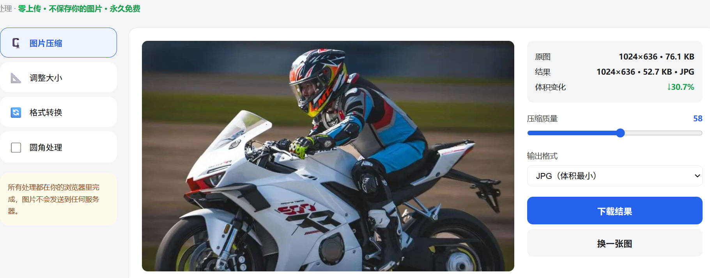
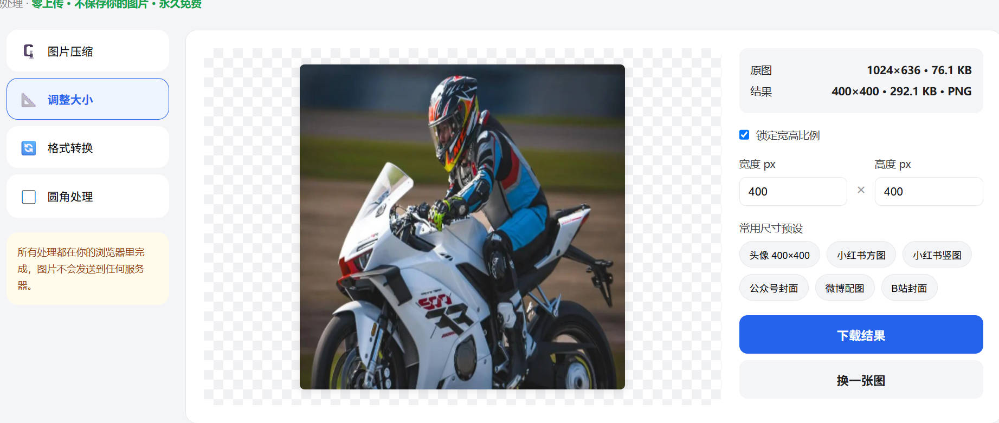

# Image Toolkit · 轻量在线图像工具箱

[](LICENSE)
[]()
[]()

一个**纯前端、零依赖、零上传**的轻量图像处理工具箱。所有处理都在你的浏览器本地完成，图片不经过任何服务器，永久免费。

> 不需要安装、不需要后端、不需要联网处理，打开即用。





## 功能

| 工具 | 说明 |
|---|---|
| 🗜️ **图片压缩** | 质量滑块实时调节，可选 JPG / WebP / PNG，实时显示压缩率 |
| 📐 **调整大小** | 锁定宽高比例，自定义宽高，内置头像 / 小红书 / 公众号 / 微博 / B站等常用尺寸预设 |
| 🔄 **格式转换** | JPG / PNG / WebP 互转，转 JPG 自动填充白底 |
| ▢ **圆角处理** | 自定义圆角半径，导出带透明背景的 PNG |

## 快速开始

### 本地使用（推荐）

直接用浏览器打开 `index.html` 即可，无需任何安装：

```bash
# 克隆仓库
git clone https://github.com/payday987/image-toolkit.git
cd image-toolkit

# 直接双击 index.html，或用任意浏览器打开
```

### 在线使用

打开仓库后，点击 `index.html` 文件即可在浏览器中预览使用。

## 使用说明

1. 点击「点击选择图片」，或将图片拖拽到虚线框内
2. 在左侧选择需要的工具
3. 调节参数，右侧实时预览结果和体积变化
4. 点击「下载结果」保存处理后的图片

## 技术说明

- 全部基于浏览器原生 **Canvas API** 实现，无任何第三方库、无构建步骤
- 图片仅在内存中处理，使用 `URL.createObjectURL` 本地预览，**不上传、不留存**
- 响应式布局，桌面与移动端均可使用

## 路线图

- [ ] 批量处理：多图批量压缩 / 转换 / 缩放，打包下载
- [ ] 更多格式：GIF、BMP、TIFF 互转
- [ ] 水印添加、旋转、翻转
- [ ] 截图拼接 / 长图

## 贡献

欢迎提交 Issue 和 Pull Request。

## 许可证

[MIT](LICENSE)
